# Data, Experimental Results and Figures

This document describes the data and evaluation protocol, the main results, the paper figures and how
to read the stored results. Repository layout: [architecture.md](architecture.md); reproduction
and random seeds: [reproduction.md](reproduction.md).

## 1. Data and evaluation protocol

### 1.1 Tasks and data

| Task | Data | Train / test | Facets |
|---|---|---|---|
| `classification` | four CIFAR-10 classes: airplane, automobile, ship, truck | 20,000 / 4,000 | 4 OVR facets |
| `regression` | UTKFace age regression (32×32) | 20,000 / 2,000 | 9 threshold facets |
| `classification_full` | full ten-class CIFAR-10 | 50,000 / 10,000 | 10 OVR facets |

- Both classification and regression use in-sample evaluation: probes are fitted and evaluated on
  the training samples;
- regression images are stored as `float16`, labels as `float64`, to avoid threshold drift;
- full CIFAR-10 data is generated on demand and is not committed.

### 1.2 Noise and repeats

| Condition | Setting | Repeats |
|---|---|---|
| `gauss` | additive Gaussian, `a=0.2` | 10 |
| `salt` | salt-and-pepper, `n=64` | 10 |
| `move` | motion blur, `degree=15` | 10 |
| `occ` | occlusion, `v=192` | 10 |
| `attack` | PGD, `eps=2.0`, `alpha=0.2`, `steps=20` | 10, white-box, per model |
| `base` | clean test samples | evaluated once |

Each noise condition has ten independent draws; the same draw is shared by all models. Susceptible
samples are selected once on `base` and reused by every condition and repeat.

## 2. Main results

### 2.1 Classification and regression criteria

Average whole-network criterion over the four models and all facets (exact values in
`result/criteria/clean/<task>.csv`):

| Task | base | attack | gauss | salt | move | occ |
|---|---:|---:|---:|---:|---:|---:|
| `classification` | 1.000 | 0.340 | 0.648 | 0.723 | 0.695 | 0.797 |
| `classification_full` | 1.000 | 0.447 | 0.700 | 0.705 | 0.703 | 0.762 |
| `regression` | 1.000 | 0.434 | 0.574 | 0.670 | 0.697 | 0.758 |

Main observations:

- PGD causes the largest drop (0.34–0.45);
- Gaussian noise is more harmful than salt-and-pepper;
- occlusion and motion blur are relatively mild;
- full CIFAR-10 shows the same trend as the four-class subset.

### 2.2 Noise-trained comparison

`result/criteria/noise/` contains the gauss+salt noise-trained evaluation. Averages over models and facets:

| Task | Condition | clean-trained | noise-trained |
|---|---|---:|---:|
| `classification` | gauss | 0.648 | 0.948 |
| `classification` | salt | 0.723 | 0.980 |
| `regression` | gauss | 0.574 | 0.852 |
| `regression` | salt | 0.670 | 0.911 |

Noise-aware training substantially improves Gaussian/salt robustness, confirming that the criteria
capture real changes induced by training.

### 2.3 Standard error and significance

Each evaluation uses ten independent noise draws. The repeat-to-repeat spread is the standard
deviation `s`, and the uncertainty of the mean is `SE = s/sqrt(n-1)`. The main-experiment SE is
typically of order `1e-3`, with a maximum of about `1.3e-3`.

- per-layer, per-condition SE: `result/standard_error/`;
- paper figure `fig:std_heat`: `figure/png/standard_error_heatmap.png`;
- differences between networks are treated as significant only when they exceed `2.77·SE`.

### 2.4 Weighted scores and rankings

`result/scoring/` combines classification and regression criteria into weighted scores under four
weighting schemes: equal, PGD-dominant, Gaussian-dominant and salt-dominant.

The network rankings are broadly consistent across schemes, so the score is not sensitive to the
weight choice. Exact scores, ranks and Kendall τ: `result/scoring/score_report.md`.

## 3. Paper figures

Only figures actually used in the paper are kept. Each has a semantically named PNG preview and the
original PDF panels; PDFs are in `figure/pdf/`, PNGs in `figure/png/`, and the manifest is
`figure/manifest.json`.

### Susceptible sample selection and noise imposition

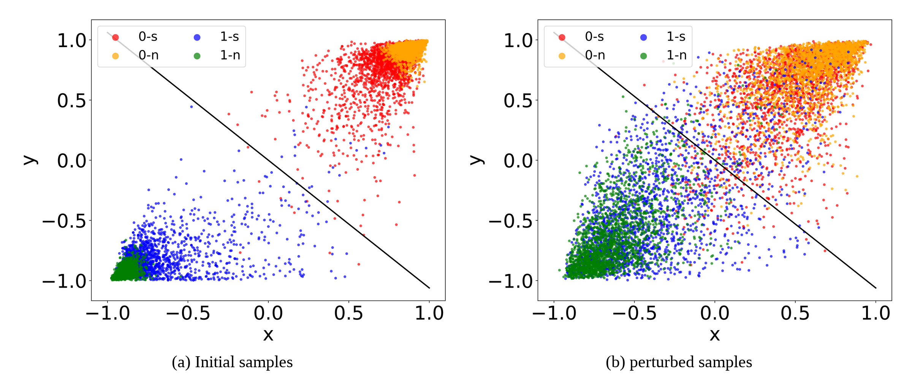

> Paper label: `fig:sel_data` · PDF panels: [open directory](../figure/pdf/)
### Weight cosine similarity under 10 random samplings

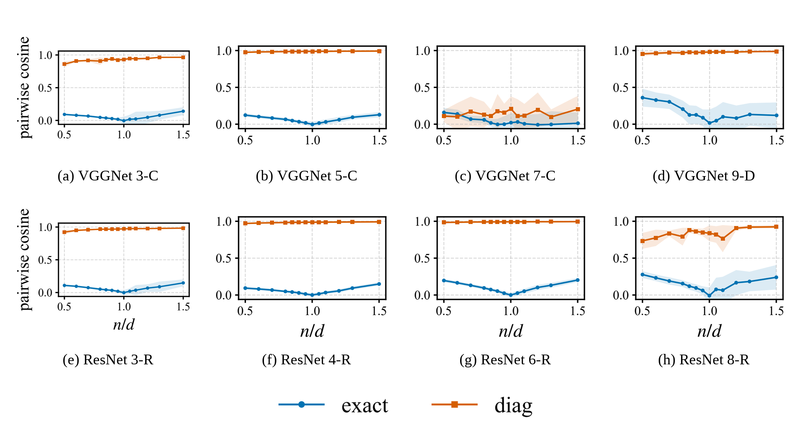

> Paper label: `fig:weight_vs_samples` · PDF panels: [open directory](../figure/pdf/panels/figure2/)
### Pairwise cosine stability under 10 Gaussian-noise realizations

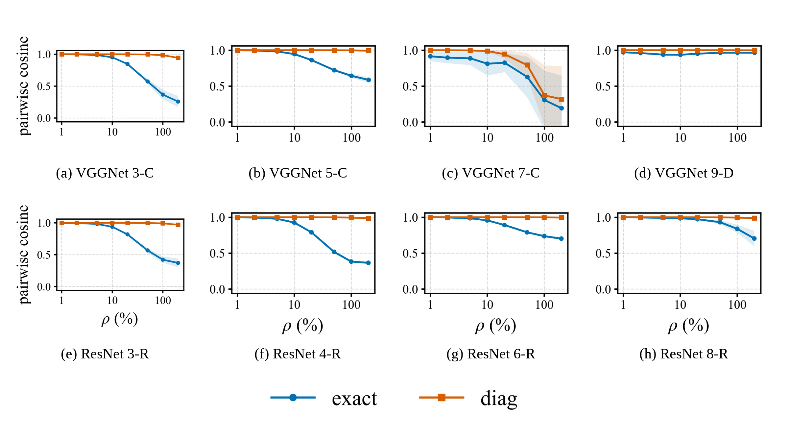

> Paper label: `fig:weight_vs_noise` · PDF panels: [open directory](../figure/pdf/panels/figure3/)
### Classification robustness criteria: overall

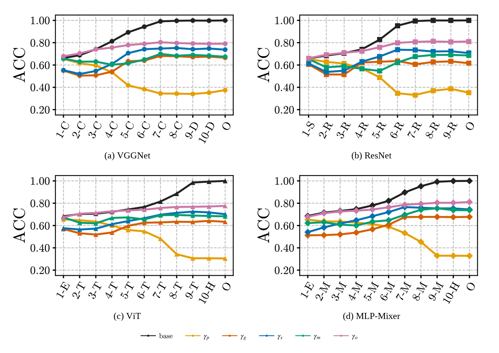

> Paper label: `fig_noi_c_over` · PDF panels: [open directory](../figure/pdf/panels/classification/overall/)
### Classification robustness criteria: per-class OVR

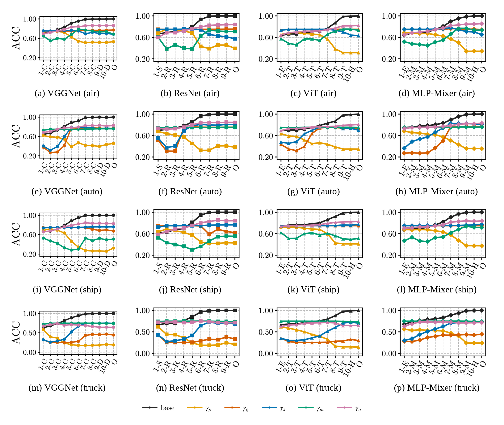

> Paper label: `fig_noi_c` · PDF panels: [open directory](../figure/pdf/panels/classification/class/c1/)
### Full CIFAR-10 robustness criteria

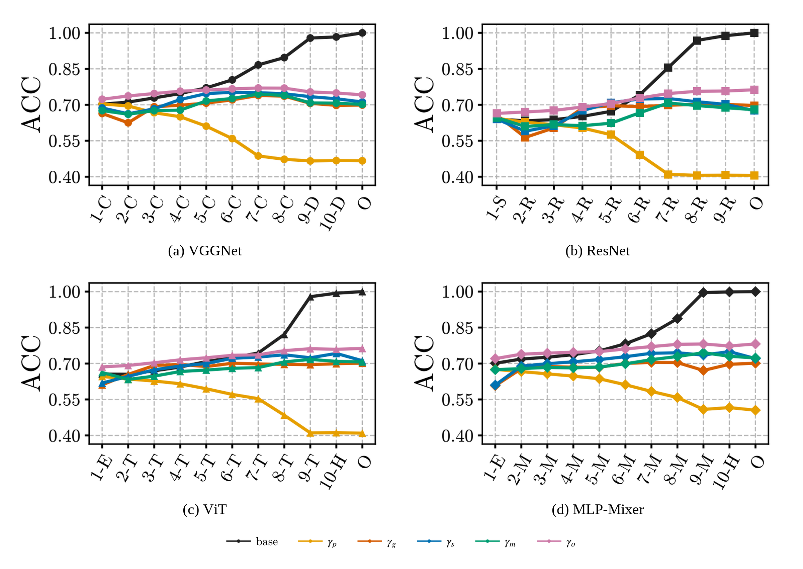

> Paper label: `fig:sub_cla_full` · PDF panels: [open directory](../figure/pdf/panels/classification_full/overall/)
### Regression robustness criteria: overall

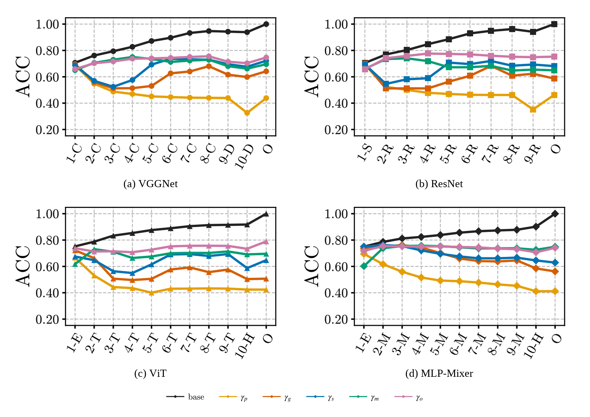

> Paper label: `fig_noi_r_over` · PDF panels: [open directory](../figure/pdf/panels/regression/overall/)
### Regression robustness criteria: thresholds 1-5

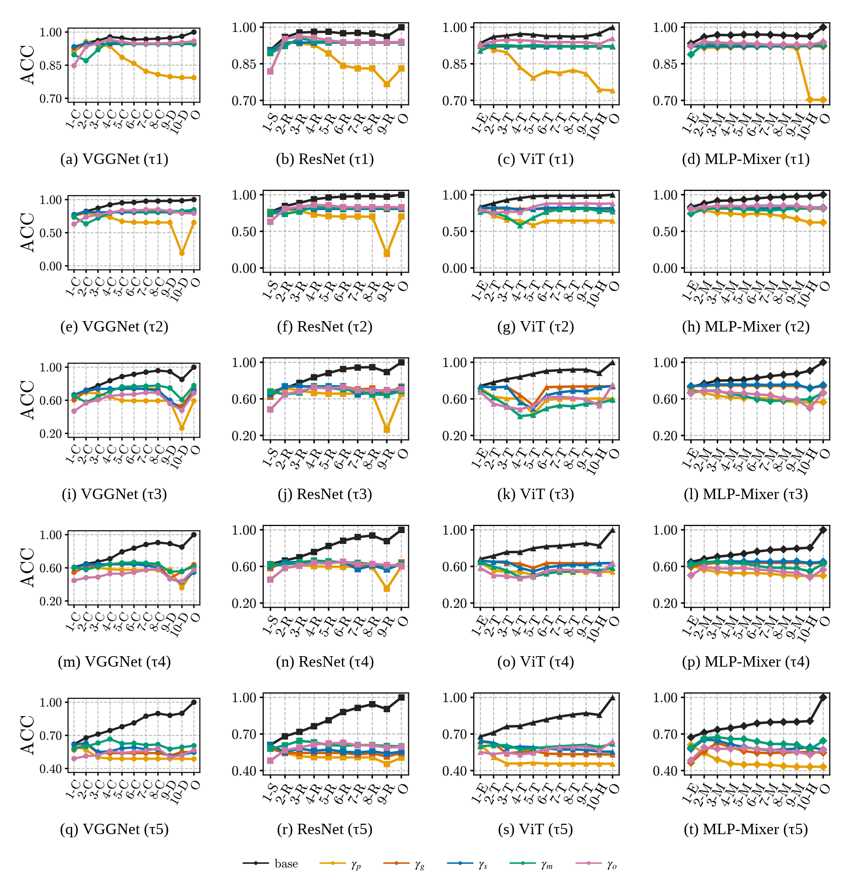

> Paper label: `fig_noi_c1` · PDF panels: [open directory](../figure/pdf/panels/regression/thrA/t1/)
### Regression robustness criteria: thresholds 6-9

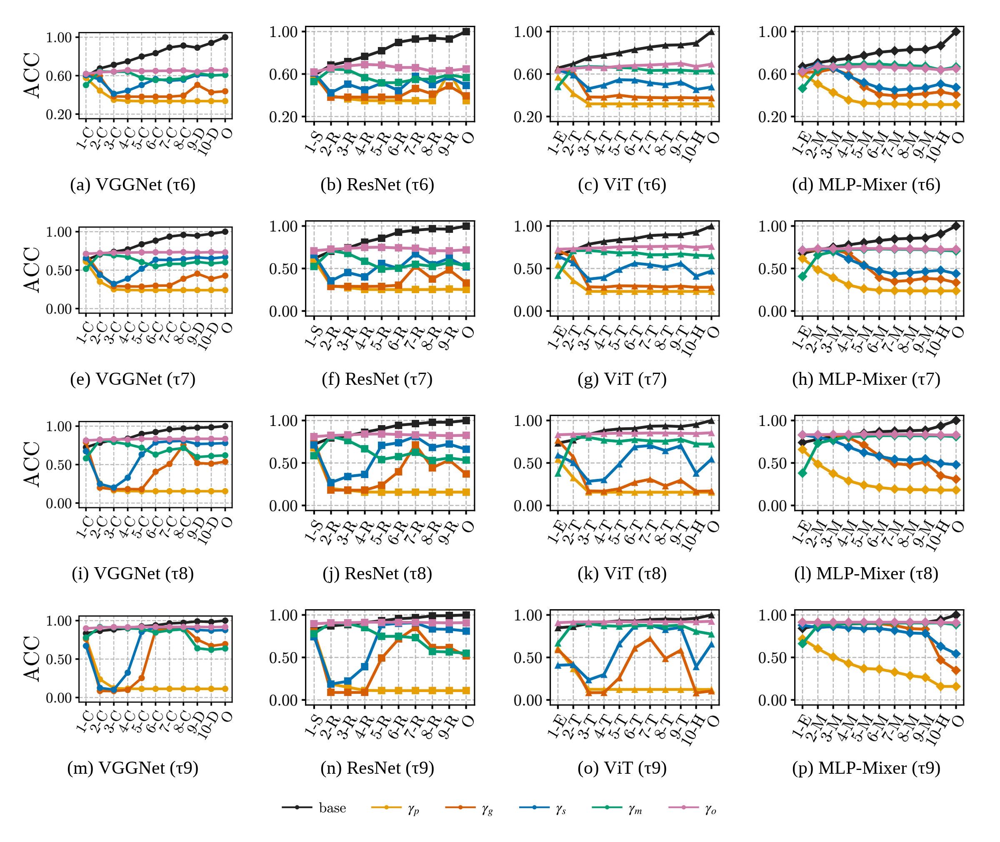

> Paper label: `fig_noi_c2` · PDF panels: [open directory](../figure/pdf/panels/regression/thrB/t6/)
### Standard error heatmap

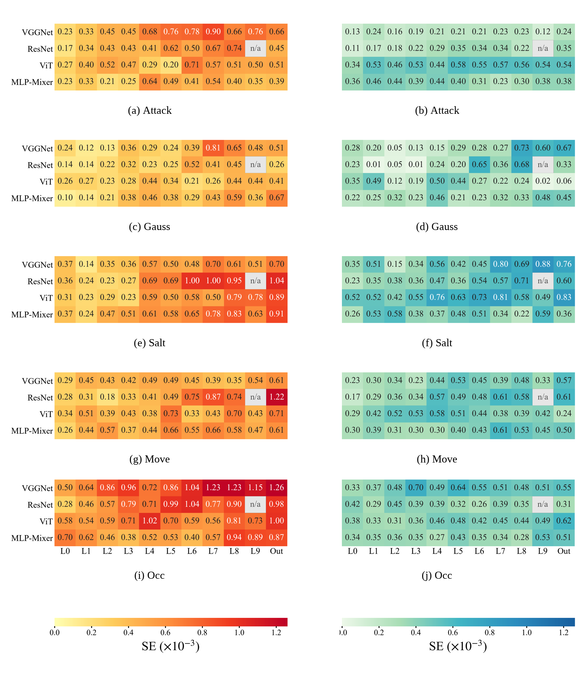

> Paper label: `fig:std_heat` · PDF panels: [open directory](../figure/pdf/panels/heatmap/classification/)
### Clean vs noise-trained comparison (radar)

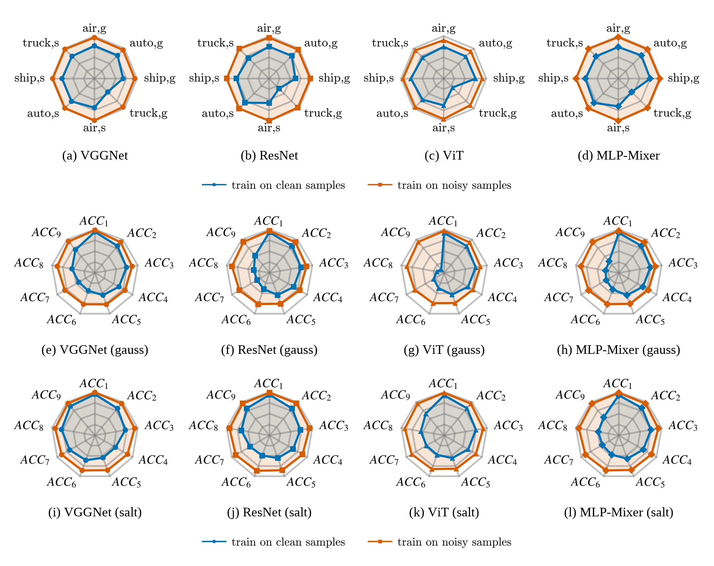

> Paper label: `fig:comp_acc` · PDF panels: [open directory](../figure/pdf/panels/classification/radar/)
### Classification noise metric comparison

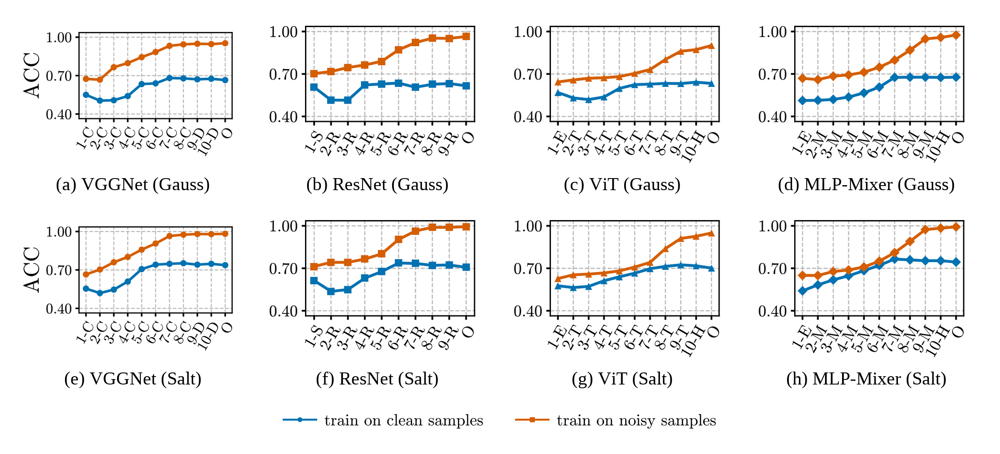

> Paper label: `fig:comp_acc_s1` · PDF panels: [open directory](../figure/pdf/panels/extra/)
### Regression noise metric comparison

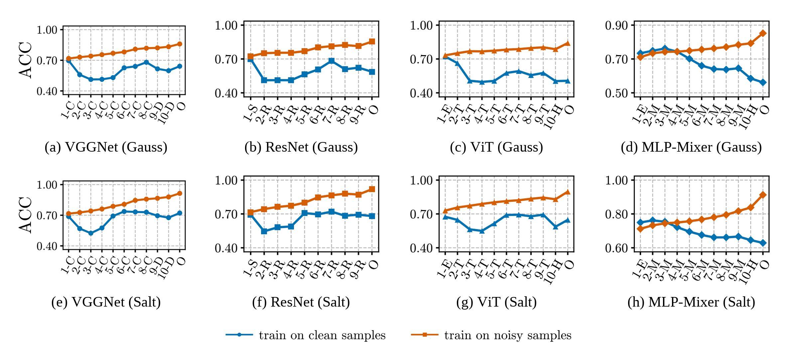

> Paper label: `fig:comp_acc_s2` · PDF panels: [open directory](../figure/pdf/panels/extra/)
### Sensitivity to susceptible-sample ratio s

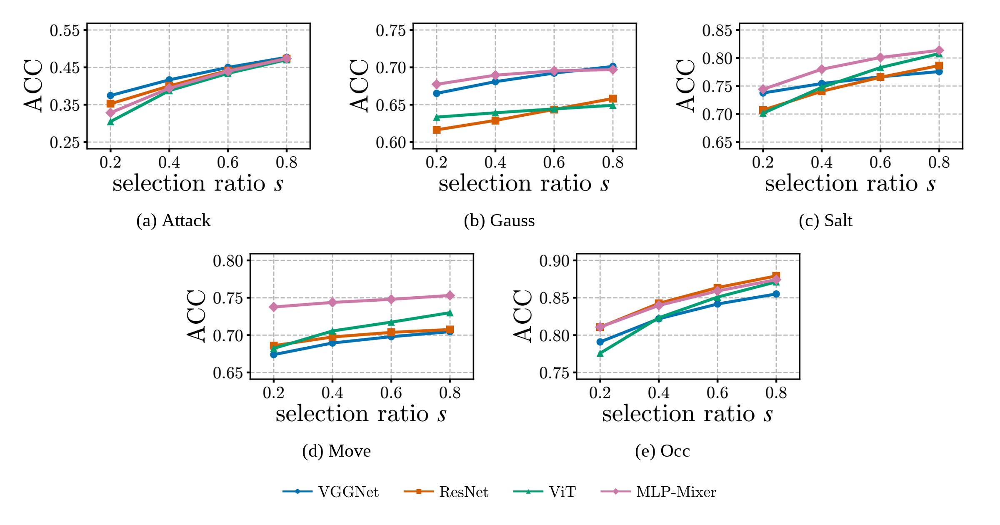

> Paper label: `fig:s_scan` · PDF panels: [open directory](../figure/pdf/panels/s_scan/)

## 4. Add-on validation experiments

| Experiment | Question | Conclusion |
|---|---|---|
| Probe construction cost | Is MD-LP affordable? | needs only feature moments; much cheaper than gradient training |
| Exact vs diagonal | Is the diagonal surrogate sufficient? | close accuracy, better numerical stability |
| Weight stability under resampling | Are weights stable across sample draws? | directions highly consistent across ten draws |
| Weight stability under feature noise | Are weights stable under Gaussian feature noise? | cosine similarity remains high |
| Rotated-noise comparison | Is MD-LP better than CKA/SVCCA/t-SNE? | MD-LP correlates more strongly with the rotated direction |
| Susceptible ratio s | Does the conclusion depend on s? | rankings remain stable over the usual s range |

Data: `result/add_exp/`; figures: `figure/generated/add_exp/` (runtime output).

## 5. Reading the results

```python
import pickle

with open("result/criteria/clean/classification/VGG-11_robustness.pkl", "rb") as f:
    rob = pickle.load(f)
print(rob["gauss"].shape)          # (11, 4): 10 hidden layers + output, 4 OVR facets
print(rob["gauss"][-1].mean())     # whole-network Gaussian criterion
```

```python
import json
d = json.load(open("result/add_exp/probe_stability/weight_vs_samples/small_n_stability_8sites_10rep.json"))
print(d["sites"]["VGG_L9"]["ratios"]["1"]["diag"]["pairwise_mean"])
```
